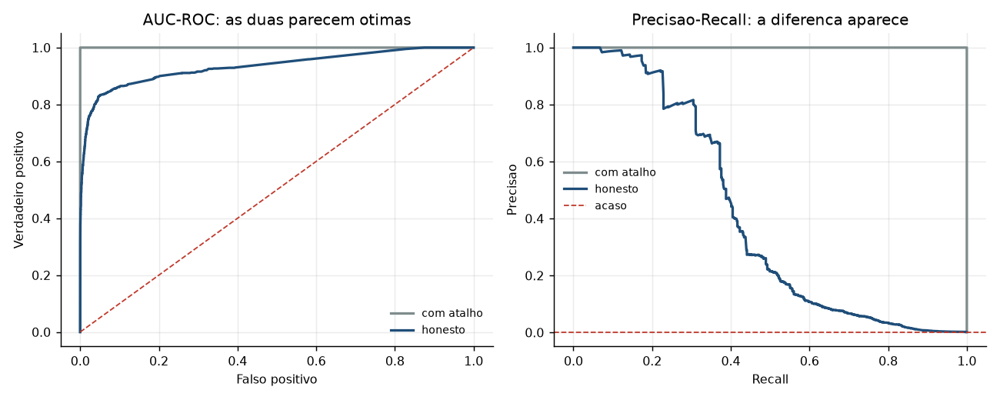
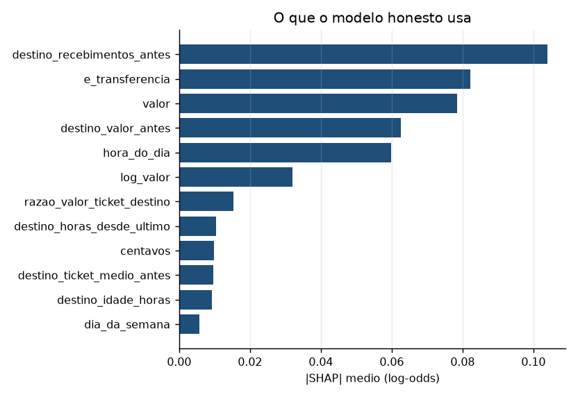
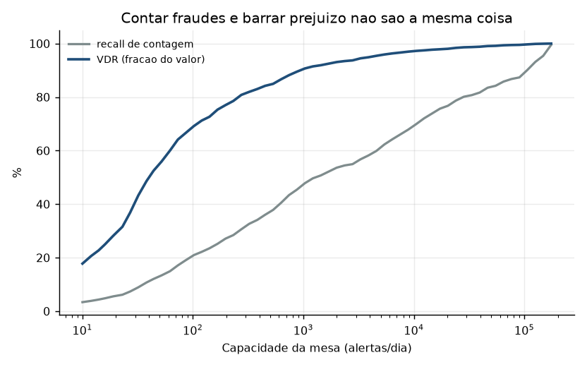
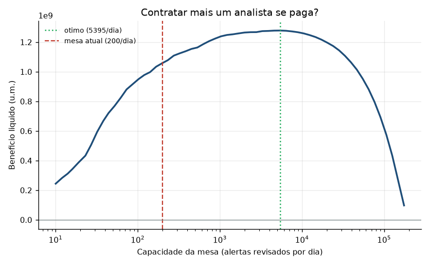

# Detecção de Fraude sob Capacidade Finita

**Uma regra de duas linhas, sem modelo nenhum, pega 97,70% das fraudes do PaySim com 99,99% de precisão.** Todo AUC de 0,99 publicado sobre esse dataset está reproduzindo essa regra com mais passos.

Este projeto faz duas coisas: audita o benchmark mais usado em portfólio de antifraude, e reconstrói a solução sem os atalhos — chegando a uma operação que decide **quais transações a mesa de análise consegue olhar hoje**, não apenas quais são suspeitas.



As duas curvas da esquerda são o mesmo problema com e sem os atalhos do simulador. Pela AUC-ROC, empate técnico. Pela precisão-recall, mundos diferentes.

---

## Parte 1 — A auditoria

O PaySim gera fraude por um roteiro fixo: assume a conta e transfere **exatamente o saldo inteiro**. Isso deixa uma marca aritmética que nenhuma fraude real tem.

| Artefato | Em fraude | Em legítima | Razão |
|---|---|---|---|
| Conta drenada ao centavo (`saldo_antes == valor`) | 97,82% | 0,0001% | 900.665× |
| Destino zerado antes e depois | 49,63% | 0,06% | 804× |
| Contabilidade da origem fecha exatamente | 99,45% | 9,21% | 11× |

Escrita como condição booleana:

```python
alerta = (saldo_origem_antes == valor) & (saldo_origem_depois == 0)
```

| | |
|---|---|
| Alertas gerados | 8.025 |
| Fraudes capturadas | 8.024 |
| Falsos positivos | **1** |
| Recall | **97,70%** |
| Precisão | **99,99%** |

Um modelo que recebe as colunas de saldo encontra isso na primeira árvore. Não é detecção de fraude — é detecção do gerador.

### O segundo artefato: o eixo temporal

Validação honesta em dado transacional é temporal. Isso exige que passado e futuro sejam comparáveis, e no PaySim não são.

O simulador emite fraude a taxa praticamente constante nos 31 dias (~270/dia) mas **para de emitir tráfego legítimo a partir do dia 17**, caindo de 180 mil transações/dia para 3 mil. No dia 30 sobram 282 transações e **todas são fraude**.

Um split temporal ingênuo — 70% do tempo para treino, 30% para teste — avaliaria o modelo numa população com prevalência 17× maior que a de treino. Na primeira execução deste projeto foi exatamente o que aconteceu: 0,21% no treino contra 3,55% no teste.

A correção foi recortar os 14 dias de volume íntegro e dividir dentro deles:

| Partição | Dias | Transações | Prevalência |
|---|---|---|---|
| treino | 0–10 | 1.566.885 | 0,1373% |
| validação | 11–13 | 510.803 | 0,1519% |
| teste | 14–16 | 523.527 | 0,1585% |

Variação de 1,15× entre partições. Agora é avaliação.

## Parte 2 — O modelo honesto

Fora: os quatro saldos e a `isFlaggedFraud` (que é a saída de uma regra do próprio simulador, e captura 16 das 8.213 fraudes).

Restam 16 features de valor, tempo e histórico do destino — todas calculadas **estritamente com o passado**.

| Métrica | Com o atalho | Honesto |
|---|---|---|
| AUC-ROC | 1,0000 | 0,9338 |
| **PR-AUC** | **1,0000** | **0,4061** |
| Precisão@100 | 1,0000 | 0,9900 |
| Precisão@1000 | 0,8300 | 0,3550 |
| VDR@1000 | 1,0000 | 0,8151 |

A AUC-ROC cai de 1,000 para 0,934 e parece que quase nada mudou. A PR-AUC cai de 1,000 para 0,406. Com 0,16% de prevalência, a taxa de falso positivo tem 523 mil transações legítimas no denominador — ela mal se move, e a curva ROC fica bonita mesmo com a fila de revisão cheia de lixo.

### O sinal que sobrou

A hipótese inicial era a conta laranja que acumula vítimas. **Ela não se confirmou:** contas que recebem fraude têm mediana de 3 recebimentos no período, igual às que nunca recebem.

O sinal só aparece na versão causal, e aponta para o lado oposto: **66,9% das fraudes vão para um destino que está recebendo pela primeira vez**, contra 18,3% das legítimas. É a conta de passagem aberta para a ocasião — que é como o golpe de Pix funciona de verdade.

O detalhe metodológico vale mais que o achado: o `groupby` sobre o período inteiro **apagou** o sinal em vez de inflá-lo. Calcular ponto a ponto no tempo não é só higiene contra vazamento; às vezes é a única forma de enxergar o que está lá.



## Parte 3 — A decisão: capacidade, não threshold

Em crédito a decisão é um corte de probabilidade, e não há limite de quantas contas aprovar. Em antifraude a mesa revisa um número fixo de alertas por dia. Se o modelo gerar 5.000 alertas e a mesa aguentar 200, os outros 4.800 **não são recusados — eles passam**.

A pergunta deixa de ser "qual o corte" e vira **quais 200 transações entram na fila hoje**. E a resposta não é "as 200 mais prováveis":

```
perda esperada evitada = p × valor × (1 − recuperação do MED)
```

Uma fraude de 50.000 com 40% de probabilidade vale mais atenção que uma de 200 com 95%.

**Mesma fila de 200 alertas/dia, mesmo modelo, duas ordens de prioridade:**

| Ordenação | Fraudes barradas | Recall (contagem) | **VDR (valor)** | Benefício líquido |
|---|---|---|---|---|
| Probabilidade | 323 | 38,9% | 73,1% | u.m. 1,00 bi |
| **Valor em risco** | **225** | **27,1%** | **77,0%** | **u.m. 1,06 bi** |

Repare no trade-off: ordenar por valor em risco pega **menos** fraudes — 225 contra 323 — e ainda assim salva 52,8 milhões a mais. **Um painel que mede recall de contagem registraria isso como piora.**



### Quanto vale mais um analista



A curva tem ótimo em 5.395 alertas/dia, mas o número que importa é a inclinação: as primeiras centenas de alertas capturam a maior parte do valor, e o retorno por analista adicional cai rápido depois disso. Com 200/dia a mesa já barra 77% do valor fraudado revisando 0,11% do tráfego.

**Uma honestidade sobre os custos:** na escala de valor do PaySim, uma fraude média custa 1,47 milhão de unidades contra 500 por revisão. O custo operacional é desprezível, então não existe aqui um ótimo econômico elegante — a conclusão real é que **a restrição da operação é headcount, não custo de revisão.** Isso está no resultado, não escondido na premissa.

## Rodando

```bash
python -m venv .venv && .venv/Scripts/activate
pip install -r requirements.txt
```

O download exige conta no Kaggle. O fluxo OAuth não pede token para gerenciar:

```bash
kaggle auth login
```

Pipeline completo — baixa, audita, treina os dois modelos e gera `reports/`:

```bash
python -m scripts.train
```

Simulador da mesa de análise:

```bash
streamlit run app/streamlit_app.py
```

Testes da camada de triagem:

```bash
python -m pytest tests/ -q
```

## Estrutura

```
src/
  config.py       premissas de operação e recorte temporal
  data.py         ingestão do PaySim
  leakage.py      auditoria dos artefatos do simulador
  features.py     16 features causais, sem os saldos
  model.py        LightGBM com métricas de evento raro
  triage.py       fila sob capacidade finita
scripts/train.py  pipeline ponta a ponta
notebooks/        EDA executada
app/              simulador da mesa
tests/            18 testes da triagem
reports/          tabelas e figuras geradas
```

## Escopo e limites

**Não existe base pública de Pix.** O PaySim (Lopez-Rojas, Elmir & Axelsson, 2016) é um simulador de transferências de dinheiro móvel calibrado sobre logs reais de um serviço africano, e foi escolhido porque a mecânica é a mesma: transferência P2P instantânea seguida de saque. A limitação é do domínio, não do projeto.

**As unidades não são reais.** A transação mediana do PaySim é de 171 mil unidades e a maior passa de 92 milhões — escala que não corresponde a Pix nenhum. Por isso os valores aparecem como `u.m.`, e não convertidos para uma moeda que daria falsa precisão.

**Só TRANSFER e CASH_OUT.** Fraude é estruturalmente impossível nos outros três tipos por construção do simulador. Mantê-los diluiria a prevalência de 0,296% para 0,129% e inflaria toda métrica sem informar nada.

**Sem features de origem.** A conta pagadora aparece uma única vez em 99,9% dos casos, então não há histórico do lado de quem paga. Metade do arsenal padrão de antifraude — velocidade por conta, desvio do comportamento habitual do cliente — é incalculável neste dataset. Um sistema real teria isso.

**O rótulo é do simulador.** Fraude confirmada em produção chega com atraso e viés: só se descobre o que foi contestado. O PaySim entrega rótulo perfeito e imediato, o que torna qualquer resultado aqui um teto otimista.

## Dados

[PaySim — Synthetic Financial Datasets For Fraud Detection](https://www.kaggle.com/datasets/ealaxi/paysim1). 6.362.620 transações, 31 dias simulados, 8.213 fraudes. Baixado pelo pipeline via API do Kaggle.
